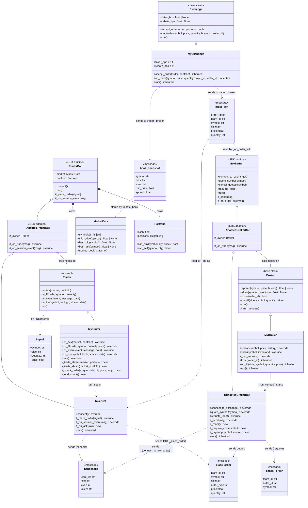

#Phase 0 UML Diagram 

#inheritance  

1. MyTrader: {base class: arena.Trader, overrides: on_tick, on_fill, on_event, on_ipo, run, added: _trader_starter, _trade_shock, _shock_order, _end_shock}
2. TakerBot: {base class: _AdaptedTraderBot which comes from TraderBot, overrides:connect, _place_order, _on_session_event, added: run, listen, trading_loop, _on_ack}
3. MyBroker:{base class: arean.Broker, overrides: spread, skew, _run_venues}
4. BudgetedBrokerBot: {Base_class: _AdaptedBrokerBot which comes from BrokerBot, overrides: connect_to_exchange, quote_symbol, requote_loop, _send, added: _room, _requote_cost, _urgency}
5. MyExchange: {base_class: arena.Exchange, overrides: taker_bps, rebate_bps}

    Additional
    - MyTrader.run() starts TakerBot instead of the SDK's default bot and
    - MyBroker._run_venues() starts BudgetedBrokerBot

#messaging between classes 
1. handshake: sent by TakerBot.connect(), recieved by BudgetedBrokerBot.connect_to_exchange(), to authenticate seat 
2. place_order: sent by TakerBot._place_order(), and BudgetedBrokerBot, received by exchange, to place an order
3. cancel_order: sent by BudgetedBrokerBot when it cancels or requotes an order, receieved by exchange, to cancel an order
4. order_ack: sent by exchange, received by TakerBot._on_ack(), and BrokerBot.on_order_ack(), to confirm an order and return its id
5. book_snapshot: sent by exchange, received by MarketData.update_book(), to get order book for a symbol

